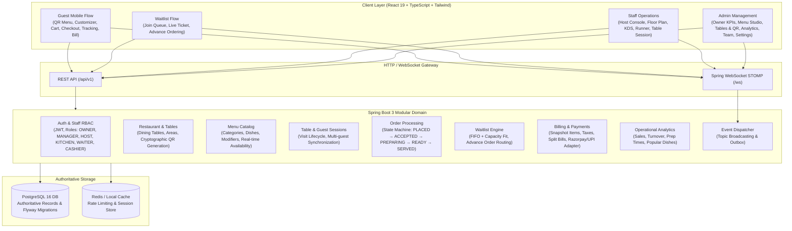

# DineFlow — Architecture & Implementation Master Plan

## 1. System Architecture

DineFlow is designed as a modular monolith with strict tenant isolation, PostgreSQL as the authoritative store, Spring WebSocket STOMP for real-time operations, and a responsive React frontend faithful to the Ember & Olive artisan visual system.

## 2. Inventory of the 21 Wireframe Screens

| Screen # | Module | Wireframe Screen | Route / View | Primary Functions |
|---|---|---|---|---|
| **1** | Customer QR | **Guest QR Menu** | `/menu/:tableId` or `/r/:slug/t/:token` | 3D food hero, categories, item cards, search, sticky cart |
| **2** | Customer QR | **Dish Details** | `/item/:itemId` | Spice level, extras, cooking notes, quantity, add to cart |
| **3** | Customer QR | **Cart** | `/cart` | Item list, +/- quantity, remove, tax/total summary, order note |
| **4** | Customer QR | **Checkout** | `/checkout` | Destination, guest name/phone, payment choice (UPI/Table/Counter), validation |
| **5** | Customer QR | **Live Order Tracking** | `/orders/:orderId` | 5-step status timeline, live prep updates, call waiter |
| **6** | Customer QR | **Bill & Payment** | `/table/:tableId/bill` | Combined session bill, bill split (1/2/3 guests), payment settlement |
| **7** | Waitlist | **Join Queue** | `/waitlist/join` | Name, phone, party size, seating preference, restaurant status |
| **8** | Waitlist | **Queue Ticket** | `/waitlist/:token` | Live token, wait time, position, table assignment alert, advance order CTA |
| **9** | Waitlist | **Advance Order** | `/waitlist/:token/order` | 2 Modes: *Prepare after seating* vs *Counter pickup now* |
| **10** | Host & Seating | **Host Console** | `/staff/host` | Waiting queue list, party capacity matching, table assign, walk-ins |
| **11** | Host & Seating | **Live Floor Plan** | `/staff/floor` | 8-table floor plan, 3D isometric view, table state transitions |
| **12** | Host & Seating | **Table Session** | `/staff/tables/:tableId/session` | Visit duration, combined orders, billing status, close session |
| **13** | Kitchen & Ops | **Kitchen Display (KDS)** | `/staff/kitchen` | Touch board: Placed, Preparing, Ready cards with timers & action buttons |
| **14** | Kitchen & Ops | **Waiter / Runner** | `/staff/runner` | Ready orders board, destination table, service confirmation, customer calls |
| **15** | Admin & Mgmt | **Owner Overview** | `/manage/overview` | Revenue, orders, occupancy, 3D seating overview, quick actions |
| **16** | Admin & Mgmt | **Menu Studio** | `/manage/menu` | Category tabs, dish inventory, stock toggle, add/edit dish modal |
| **17** | Admin & Mgmt | **Tables & QR Codes** | `/manage/tables` | Table capacity, cryptographic QR code generation, print preview |
| **18** | Admin & Mgmt | **All Orders** | `/manage/orders` | Unified orders list, filters (Placed/Preparing/Ready), search, audit details |
| **19** | Admin & Mgmt | **Staff & Roles** | `/manage/team` | Team table, role cards (Owner, Manager, Kitchen, Waiter, Host, Cashier), invite |
| **20** | Admin & Mgmt | **Analytics / Insights** | `/manage/insights` | KPIs, hourly sales chart, top dishes ranking with progress meters |
| **21** | Admin & Mgmt | **Restaurant Settings** | `/manage/settings` | Profile, operating preferences, queue grace period, tax & service charge |

## 3. Database Schema Overview (22 Tables)

- `restaurants` & `restaurant_settings`: Multi-tenant foundation, currency, timezone, tax rates, policies.
- `users`, `roles`, `restaurant_memberships`, `staff_invitations`: Role-based access control.
- `dining_areas`, `dining_tables`, `table_qr_tokens`: Physical layout and cryptographic QR identities.
- `table_sessions`, `guest_sessions`: Active customer visits and multi-guest grouping.
- `menu_categories`, `menu_items`, `modifier_groups`, `modifier_options`, `menu_item_modifier_groups`: Menu catalog.
- `orders`, `order_items`, `order_item_modifiers`, `order_status_history`: Order lifecycle and historical price snapshots.
- `queue_tickets`, `queue_status_history`: Waitlist management and advance order linkage.
- `bills`, `bill_items`, `bill_splits`, `payments`: Financial records and split billing.
- `service_requests`, `audit_logs`: Operational notifications and event history.
