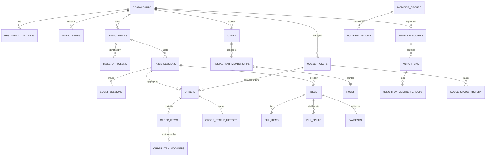

# DineFlow — Database Design Specification

## 1. Relational Schema & Tenant Isolation

Every restaurant-owned record includes a foreign key constraint to `restaurants(id)` and composite indexing `(restaurant_id, ...)` to guarantee multi-tenant performance and tenant isolation.

Financial figures use `NUMERIC(10,2)` (mapped to `java.math.BigDecimal`) to prevent IEEE-754 floating-point inaccuracies.

## 2. Entities & Invariants

1. **`restaurants`**: Core tenant entity (`id`, `name`, `slug` UNIQUE, `logo_url`, `currency`, `timezone`, `created_at`).
2. **`restaurant_settings`**: Configurable policies (`allow_qr_ordering`, `allow_counter_pickup`, `require_staff_acceptance`, `allow_cancellation`, `no_show_grace_minutes`, `seating_strategy`, `default_tax_rate`, `service_charge_rate`).
3. **`users` & `restaurant_memberships`**: RBAC credentials, hashed passwords (BCrypt), role assignment (`OWNER`, `MANAGER`, `HOST`, `KITCHEN`, `WAITER`, `CASHIER`).
4. **`dining_tables`**: `table_number` (e.g. `T01`), `seats_capacity`, `status` (`AVAILABLE`, `OCCUPIED`, `CLEANING`, `RESERVED`, `INACTIVE`).
5. **`table_qr_tokens`**: Unguessable cryptographic public token string, SHA-256 token hash, active flag, expiration.
6. **`table_sessions`**: Single active visit per table (`active` flag with unique partial index on table_id WHERE active = true), start time, end time, guest count, total bill status.
7. **`menu_items`**: Dish name, description, price, category, emoji/image, tag, availability flag, preparation time.
8. **`orders`**: Order number (e.g. `TF-1049`), order type (`DINE_IN`, `COUNTER_PICKUP`, `ADVANCE_ORDER`), status (`PLACED`, `ACCEPTED`, `PREPARING`, `READY`, `SERVED`, `COMPLETED`, `CANCELLED`), subtotal, tax amount, total amount, order notes. Historical snapshots of item names and prices preserved.
9. **`queue_tickets`**: Ticket token (e.g. `Q-018`), party size, seating preference, status (`WAITING`, `NOTIFIED`, `SEATED`, `CANCELLED`, `NO_SHOW`, `EXPIRED`), assigned table, estimated wait minutes, advance order linkage.
10. **`bills` & `payments`**: Bill number, subtotal, tax, service charge, final total, split type, paid status, payment method, payment reference.
